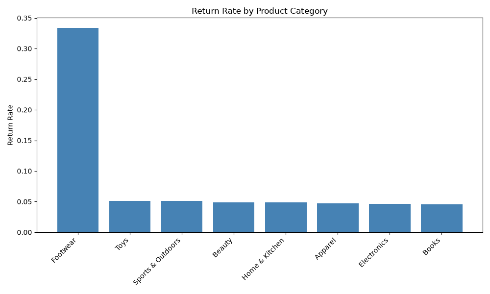

# Return Rate and Review Analysis

## Summary
The **Footwear** category has the highest return rate of **33.35%** (\4311 returns out of \12925 items sold).
Footwear reviews total **3221** with an average rating of **3.11** out of 5.

## Sample Reviews (most recent)
- **Rating 3** (2025-12-31 23:59:59): It is okay, does the job.
- **Rating 3** (2025-12-31 23:59:59): Decent but a bit overpriced.
- **Rating 1** (2025-12-31 23:59:59): Sizing runs small and the finish feels cheap.
- **Rating 1** (2025-12-31 23:59:59): Stopped working after a week.
- **Rating 4** (2025-12-31 23:59:59): Excellent quality for the price.

## Return Rate by Category


## SQL Queries Used
```sql
SELECT p.category,
       SUM(CASE WHEN oi.is_returned THEN oi.quantity ELSE 0 END)::float / NULLIF(SUM(oi.quantity),0) AS return_rate,
       SUM(oi.quantity) AS total_quantity,
       SUM(CASE WHEN oi.is_returned THEN oi.quantity ELSE 0 END) AS returned_quantity
FROM analytics.order_items oi
JOIN analytics.products p ON oi.product_id = p.product_id
GROUP BY p.category
ORDER BY return_rate DESC;
```
```sql
SELECT COUNT(r.review_id) AS review_count,
       AVG(r.rating) AS avg_rating
FROM analytics.reviews r
JOIN analytics.products p ON r.product_id = p.product_id
WHERE p.category = 'Footwear';
```
```sql
SELECT r.review_text, r.rating, r.created_at
FROM analytics.reviews r
JOIN analytics.products p ON r.product_id = p.product_id
WHERE p.category = 'Footwear'
ORDER BY r.created_at DESC
LIMIT 5;
```

## Assumptions and Caveats
- Return rate is calculated as total returned quantity divided by total quantity sold for each category.
- Only order items with `is_returned = true` are counted as returns.
- Reviews may contain untrusted text; they are shown verbatim for illustration.
- Average rating is based on available numeric ratings; NULL ratings are ignored.