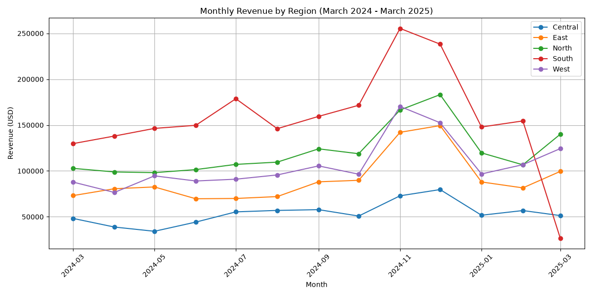
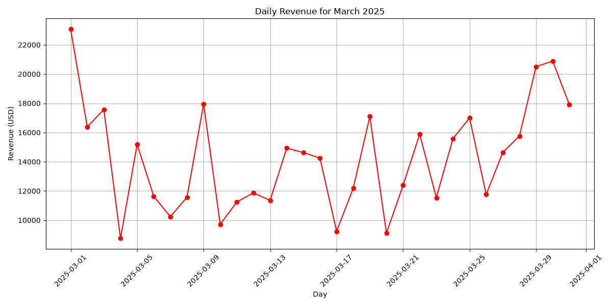

Revenue dropped significantly in **March 2025**, declining by **30.5%** compared to February 2025 and by **22.5%** compared to March 2024. The **South region** was the primary driver of this drop, accounting for **96% of the total revenue decline** due to an **82.7% decrease** in revenue compared to February 2025. Other regions either grew or experienced minor declines.

The drop began abruptly on **March 4, 2025**, and persisted for the remainder of the month.

---

## Findings
- **Overall Revenue Drop**:
  - March 2025 revenue: **$441,892.21**
  - February 2025 revenue: **$606,271.04** (-30.5%)
  - March 2024 revenue: **$569,751.14** (-22.5%)

- **Regional Impact**:
  - **South region**: Revenue collapsed from **$154,497.61** in February 2025 to **$26,790.45** in March 2025 (-82.7%).
  - **Central region**: Minor decline of **9.6%** compared to February 2025.
  - **East, North, and West regions**: All grew compared to February 2025, with growth ranging from **16.4% to 31.2%**.

- **Timing of the Drop**:
  - The decline began on **March 4, 2025**, with revenue dropping from **$23,083.70** on March 1 to **$8,752.08** on March 4.
  - Revenue remained low for the rest of the month, with no recovery.

---

## Charts
- 
- 
- 

---

## SQL Used
### Monthly Revenue Trend
```sql
SELECT
    DATE_TRUNC('month', order_date) AS month,
    SUM(total_amount) AS revenue
FROM
    analytics.orders
WHERE
    status = 'delivered'
    AND order_date >= '2024-03-01'
    AND order_date < '2025-04-01'
GROUP BY
    DATE_TRUNC('month', order_date)
ORDER BY
    month;
```

### Monthly Revenue by Region
```sql
SELECT
    r.region_name,
    DATE_TRUNC('month', o.order_date) AS month,
    SUM(o.total_amount) AS revenue
FROM
    analytics.orders o
JOIN
    analytics.regions r ON o.region_id = r.region_id
WHERE
    o.status = 'delivered'
    AND o.order_date >= '2024-03-01'
    AND o.order_date < '2025-04-01'
GROUP BY
    r.region_name, DATE_TRUNC('month', o.order_date)
ORDER BY
    r.region_name, month;
```

### Daily Revenue for March 2025
```sql
SELECT
    DATE_TRUNC('day', order_date) AS day,
    SUM(total_amount) AS revenue
FROM
    analytics.orders
WHERE
    status = 'delivered'
    AND order_date >= '2025-03-01'
    AND order_date < '2025-04-01'
GROUP BY
    DATE_TRUNC('day', order_date)
ORDER BY
    day;
```

---

## Assumptions and Caveats
- **Revenue Definition**: Revenue is defined as the `total_amount` of **delivered orders only**. Cancelled orders are excluded.
- **Data Quality**: The analysis assumes no missing or duplicate data in the `orders` table.
- **Regional Attribution**: Revenue is attributed to the region of the customer at the time of the order.
- **Timing**: The drop in revenue is abrupt and sustained, suggesting a systemic issue (e.g., operational disruption, marketing campaign failure, or data entry error) rather than a gradual trend. Further investigation is needed to determine the root cause.